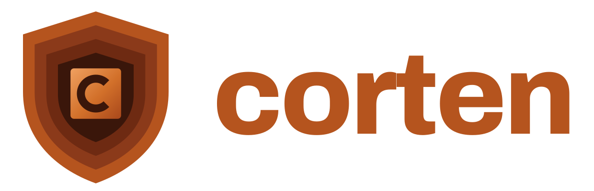

<p align="center"></p>

# Corten

**Corten is a hardened Rust profile that makes whole classes of security bugs impossible to write, and makes the rest mechanically checkable.**

> Status: **Phases 0 to 5 implemented, Phase 6 in progress; the Phase 1 to 3 gates are partly passed.** `cargo corten check` builds a crate under the Phase 1 profile (no `unsafe`, checked arithmetic, no `as` casts, no discarded results, no ambient `std` authority) with a configuration the checked repository cannot switch off. `corten-std` provides directory capabilities on `openat2`, typed SQL, HTML, process, log, header, CSV, LDAP and XPath sinks with compile-time templates, `Secret`, and a signed capability manifest. Phase 3 adds a supervision tree, process and Wasm brokers, a Landlock sandbox, a dependency policy, and `cargo corten build`: a sandboxed build on Linux with an SBOM and provenance. Phase 3b adds Corten's own lints as a rustc driver on a pinned nightly, which the checker requires ([`docs/gates/phase-3b.md`](docs/gates/phase-3b.md)). Phase 4 adds range refinements, confidentiality labels and lock-order contracts to `corten-std` ([`docs/gates/phase-4.md`](docs/gates/phase-4.md)). Phase 5 adds dependency-effect checks, encoder fixes and a verification-tool survey ([`docs/gates/phase-5.md`](docs/gates/phase-5.md)); Phase 6 mitigates the CWEs that remain under Rust and Corten, so far with cryptography, randomness, `NetCap` (TLS 1.3 connections to granted destinations), key rotation, signed-manifest expiry and DirCap file modes ([`docs/gates/phase-6.md`](docs/gates/phase-6.md)). 149 E claims are verified by the compile-fail corpus, with 0 false rejections; 31 more pass but wait for an independent review (26 encoder rows, 5 cryptography rows). Open gaps are in [`docs/gates/phase-1.md`](docs/gates/phase-1.md), [`phase-2.md`](docs/gates/phase-2.md), [`phase-3.md`](docs/gates/phase-3.md) and the remaining-work table of [`phase-6.md`](docs/gates/phase-6.md). Every "impossible to write" claim in this repository is a target to be proven by tests, not a property you get today.

## What Corten is

Corten is a security profile of Rust: same syntax, compiler and tooling, but with a locked-down standard library and stricter rules.

Its goal is to remove security bugs by construction instead of finding them later. Code can't touch files, the network or processes without being explicitly handed that permission. No string can become a SQL query, HTML or a shell command without going through a typed builder. Arithmetic is always checked, errors can't be silently ignored, and memory-unsafe or foreign code runs isolated, never in-process.

It's measured against all 944 weaknesses in MITRE's CWE catalogue. The target is to make roughly a fifth of them impossible to write and most of the rest mechanically checkable, while being honest about the small share no language can fix: business logic, intent and design.

### What it is not

- **Not a new language.** It's Rust with a stricter profile.
- **Not "bulletproof".** It can enforce a wrong policy perfectly. Authorization rules, business logic and requirements are still your job.
- **Not finished.** All five phases are implemented, the earlier gates are not all passed, and Phase 4's mechanisms back C rows only.

## Why "Corten"

Corten is weathering steel, introduced by U.S. Steel in 1933. Ordinary steel rusts and keeps rusting until it fails. Weathering steel rusts on purpose: the first layer of rust seals the metal underneath, and that layer renews itself as it weathers.

That is the idea of this profile. The Rust language already has the material for a strong defence (ownership, a strict type system, explicit `unsafe`); Corten turns those features into the protective layer, so the code is guarded by Rust itself rather than by something bolted on afterwards.

The name also avoids a wrong story. The panel first called the design "Ferrum" (Latin for iron), as if the goal were iron without rust. But Rust is not named after iron oxide: its creator, Graydon Hoare, named it after rust fungi, which he called "over-engineered for survival" ([MIT Technology Review, 2023](https://www.technologyreview.com/2023/02/14/1067869/rust-worlds-fastest-growing-programming-language/)). Corten keeps Rust and makes it the armour.

"COR-TEN" is a trademark of United States Steel Corporation. Its US registration (575534, for steel) was cancelled on 2016-04-01 because no Section 8 declaration was filed ([USPTO TSDR, serial 71628657](https://tsdr.uspto.gov/#caseNumber=71628657&caseSearchType=US_APPLICATION&caseType=DEFAULT&searchType=statusSearch)), but its Canadian registration (UCA4859, for metal sheets, plate and shapes) is live until 2035 ([CIPO 0166425](https://ised-isde.canada.ca/cipo/trademark-search/pdf/0166425?lang=eng)). Both records were checked on 2026-10-29; other US filings for the name were not searched, and this is not legal advice. This project uses the generic spelling "Corten" for software and is not affiliated with U.S. Steel.

## Where the design came from

The design was produced in October 2026 by a panel of five frontier models from five vendors (OpenAI, Google, xAI, DeepSeek, Alibaba's Qwen). Each wrote a blind proposal, they debated for three rounds while seeing each other only as anonymous letters, and all five ratified a joint specification with reservations. Two of the five started out proposing a new language; all five converged on a Rust profile. The panel ran inside the author's AethelGard project. The panel named the design Ferrum; it was renamed Corten on 2026-10-26 (see above).

The drafted classification of the 944 CWE weaknesses:

| Bucket | Meaning | Ids |
| --- | --- | ---: |
| E | Eliminated by construction: cannot be written | 186 (108 undisputed) |
| C | Mechanically checkable once the policy is stated | 710 |
| O | Out of reach of any language | 26 |
| N | Not a coding weakness | 22 |

Treat E = 186 as a ceiling: in ratification the panel challenged 78 of those ids down to C.

Which of the 944 can be written in Rust was reviewed per CWE on 2026-10-27 ([`docs/rust-applicability.md`](docs/rust-applicability.md), with a program wherever the compiler decides): **787** with `unsafe` allowed, **729** in safe Rust (five of them only through a crate with a safe API, re-reviewed 2026-11-04: [`audit/applicability/crates`](audit/applicability/crates/README.md)), **635** in safe Rust under Corten's verified eliminations (605 if every claimed elimination held). The other 157 need a construct Rust lacks (67) or are not weaknesses of code (90).

Phase 0 (2026-10-26) re-bucketed the disputed ids in the ledger: today it holds **E 180 / C 721 / O 26 / N 17**, or E 157 / C 604 / O 26 / N 0 of the 787 that can be written in Rust (six more E rows moved to C on 2026-10-27 and 28, CWE-1113 to 1117 from N to C on 2026-10-29, and eight rows from C to E on 2026-11-02 under question 21: [`docs/gates/claimed-eliminations.md`](docs/gates/claimed-eliminations.md), [`docs/gates/phase-5.md`](docs/gates/phase-5.md), [`docs/gates/phase-6.md`](docs/gates/phase-6.md)). Every E row names its mechanism, its TCB assumption ([`docs/tcb.md`](docs/tcb.md)) and a compile-fail test; **146 of the 177 are verified** (Phases 1 to 6); the other 31 pass their corpus cases and wait for an independent review (26 encoder rows, 5 cryptography rows). `cargo run -p corten-ledger -- totals` recomputes these numbers. [`docs/rust-comparison.md`](docs/rust-comparison.md) compares plain Rust and Corten category by category.

## How it will be enforced

A rule only holds if the check that enforces it runs somewhere the code's author cannot change. Corten is planned in five layers: crates that make the safe way easy (`corten-std`, typed sinks); `cargo corten check`, which builds with flags and lints it supplies itself; the same rules applied to every dependency; a CI gate that signs proof the build passed; and a deployment check plus runtime sandbox that refuse anything without that proof. Layers 1 to 3 exist, layer 4 as a GitHub Action ([`action.yml`](action.yml)) whose provenance the caller signs, and layer 5 as a Landlock launcher on Linux. Details, including a test showing why in-repo rules alone are not enough: [`docs/spec.md`](docs/spec.md) section 10.

## Repository layout

| Path | What it is |
| --- | --- |
| [`docs/spec.md`](docs/spec.md) | The full design: mechanisms, ratification amendments, open decisions, roadmap, enforcement model, risks |
| [`docs/rust-applicability.md`](docs/rust-applicability.md) | Every one of the 944 CWEs: can it be written in Rust with `unsafe`, in safe Rust, and what Corten does, with reasoning (generated from `audit/applicability/`) |
| [`docs/residual-mitigation.md`](docs/residual-mitigation.md), [`docs/residual-cwes.md`](docs/residual-cwes.md) | Proposal for the 635 CWEs that remain under Rust and Corten, and the per-CWE map of them by mitigation strategy (generated by `scripts/residual-map.py` from the ledger's `strategy` column); Phase 6 builds it out ([`docs/gates/phase-6.md`](docs/gates/phase-6.md)) |
| [`docs/rust-comparison.md`](docs/rust-comparison.md) | How many CWEs can be written in Rust (787 with `unsafe`, 729 safe), what plain Rust does about each category today, and how Corten mitigates it |
| [`ledger/cwe-ledger.csv`](ledger/cwe-ledger.csv) | One row per CWE with its MITRE category, Rust applicability, drafted bucket, and the panel's disputes with their reasons; columns for mechanism, TCB assumption and proof test, to be filled in |
| [`docs/pathseg.md`](docs/pathseg.md) | Normative `PathSeg` grammar and the `DirCap` monitor that the path-family E claims rest on |
| [`docs/netcap.md`](docs/netcap.md) | Design of `NetCap`, mostly built (its status line lists what is not): name resolution and its logging, the public-resolver fallback, the TLS client, and the network attack vectors mapped to CWEs |
| [`docs/gates/`](docs/gates) | Gate reports per phase, and the generated corpus report |
| [`corpus/`](corpus) | Compile-fail corpus: per E row, programs exhibiting the weakness and a matched benign program |
| [`docs/tcb.md`](docs/tcb.md) | What every E claim trusts, the fail-closed rule, and the enumerated implementation-defined behaviour |
| [`ledger/NOTICE`](ledger/NOTICE) | MITRE CWE copyright and licence |
| [`crates/cargo-corten`](crates/cargo-corten) | `cargo corten check`: builds a crate with flags the checker supplies itself, plus the dependency policy; `cargo corten build`: the sandboxed build with SBOM and provenance. Its README lists what it overrides and its known gaps |
| [`crates/corten-corpus`](crates/corten-corpus) | Runs the corpus; reports detection beside false rejection and marks verified rows |
| [`crates/corten-ledger`](crates/corten-ledger) | `corten-ledger check` (the ledger gate, run in CI) and `corten-ledger totals` |
| [`crates/corten-std`](crates/corten-std) | The capability prelude: `DirCap`, typed sinks, `Secret`, the signed manifest |
| [`crates/corten-runtime`](crates/corten-runtime) | Supervision tree: a panicked component is restarted, not the service |
| [`crates/corten-broker`](crates/corten-broker) | Process and Wasm brokers with quotas and deadlines; size-checked IPC frames |
| [`crates/corten-sandbox`](crates/corten-sandbox) | Landlock launcher (Linux): grants by flag or by signed capability manifest, run only for the program whose SHA-256 the manifest pins |
| [`crates/corten-manifest`](crates/corten-manifest) | The deployer's tool: `keygen` creates a signing key (mode 0600) and prints the `--trusted-key` argument; `sign` writes and signs a format 3 manifest (serial from the clock, 90-day default expiry, program digest from the build's provenance) |
| [`crates/corten-sha256`](crates/corten-sha256) | SHA-256 without dependencies, shared by the checker's provenance and the launcher's program check |
| [`action.yml`](action.yml), [`scripts/hermetic-smoke.sh`](scripts/hermetic-smoke.sh) | The layer 4 GitHub Action, and the end-to-end test of the sandboxed build |
| [`CHANGELOG.md`](CHANGELOG.md) | What changed, newest first |
| [`docs/assets/logo/`](docs/assets/logo) | The logo, favicon and GitHub social preview, with the script that renders them |
| [`AGENTS.md`](AGENTS.md) | Ground rules for contributors and AI coding agents (also read via `CLAUDE.md`) |

## Quick start

Check a crate of your own with `cargo corten check`. You need rustup, and Rust 1.98.0 or later for the crate being checked (the checker refuses older releases, which falsely reject every binary crate). On Linux, the checker runs the build inside `corten-sandbox` and refuses without it; elsewhere it warns that build scripts and procedural macros run unsandboxed.

```console
$ git clone https://github.com/martinholovsky/corten-rs.git && cd corten-rs
$ cargo install --path crates/cargo-corten --locked
$ cargo install --path crates/corten-sandbox --locked     # Linux only
$ export CORTEN_DRIVER="$(scripts/build-driver.sh)"        # Corten's own lints, on a pinned nightly
$ cd path/to/your-crate && cargo corten check
```

`scripts/build-driver.sh` installs the nightly that `crates/corten-lints` pins, with `rustc-dev`, on first use. A crate with dependencies also needs a dependency policy: dependencies are refused unless the operator admits them ([`crates/cargo-corten/README.md`](crates/cargo-corten/README.md), "Dependency policy"). Measured from a fresh clone to a passing check of a `cargo new` crate: 102 to 141 s on Linux in a `rust:1.99.1` container, 14 to 19 s on macOS with the toolchains already installed ([`docs/gates/phase-6.md`](docs/gates/phase-6.md), "Developer friction").

## Building

The toolchain is pinned in `rust-toolchain.toml` (Rust 1.99.1); rustup installs it on first use. `cargo-corten`, part of the trusted base, has no third-party dependencies; the prelude's are reviewed in [`docs/gates/phase-6.md`](docs/gates/phase-6.md).

```console
$ cargo test --workspace
$ cargo clippy --workspace --all-targets --all-features -- -D warnings
$ cargo deny check
```

CI (`.github/workflows/ci.yml`) runs fmt, clippy, rustdoc, nextest and doctests, the ledger gate, the compile-fail corpus, cargo-deny, and a gitleaks scan of the full history. To run the corpus locally:

```console
$ cargo build -p cargo-corten && cargo run -p corten-corpus -- --checker target/debug/cargo-corten
```

## Where to help

The roadmap in [`docs/spec.md`](docs/spec.md) section 9 starts with Phase 0: turning the ledger into a per-CWE record of mechanism and proof test, and settling the nine open design decisions in section 8. Issues and pull requests on either are welcome. Read [`AGENTS.md`](AGENTS.md) first; commits run a gitleaks secret scan through pre-commit (`pre-commit install --hook-type pre-commit --hook-type pre-push`).

## License

Licensed under either of

- Apache License, Version 2.0 ([LICENSE-APACHE](LICENSE-APACHE))
- MIT license ([LICENSE-MIT](LICENSE-MIT))

at your option.

Unless you explicitly state otherwise, any contribution intentionally submitted for inclusion in this work by you, as defined in the Apache-2.0 license, shall be dual licensed as above, without any additional terms or conditions.

CWE names and identifiers are © The MITRE Corporation and used under the [CWE Terms of Use](https://cwe.mitre.org/about/termsofuse.html); see [`ledger/NOTICE`](ledger/NOTICE). CWE is a trademark of The MITRE Corporation. Corten is not affiliated with or endorsed by MITRE.
